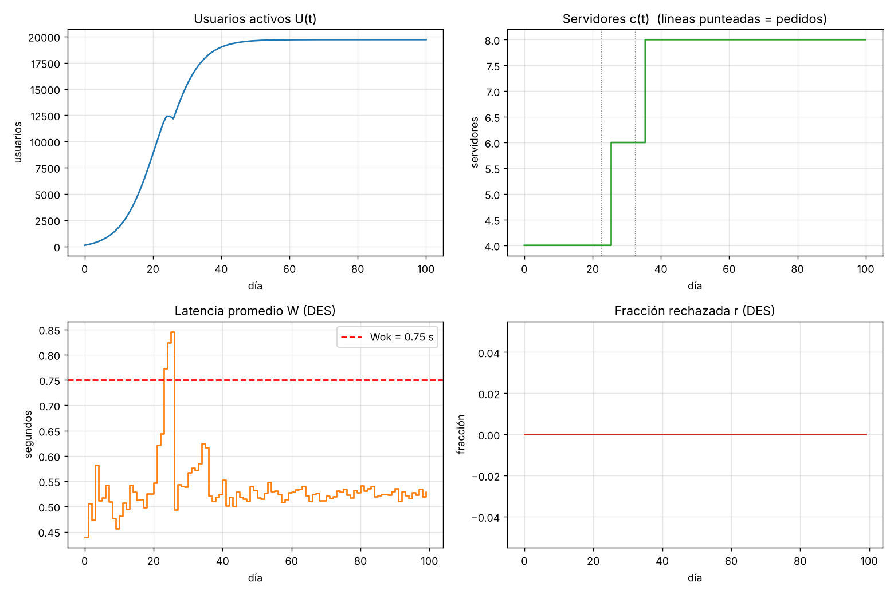

> Transcripción del texto de la respuesta de la IA a partir de las capturas de pantalla entregadas por el grupo (el chat no se exportó como texto). Las capturas muestran el inicio y el final de la respuesta; las líneas que quedaron tapadas por el botón de desplazamiento o cortadas se marcan con […]. El código que la IA entregó está en `codigo_original.py`.

Ya ejecuté el modelo completo. Estos son los resultados con la semilla 42:

| Resultado | Valor |
|---|---|
| U(100) | ≈ 19 703 usuarios |
| Servidores finales | 8 |
| Latencia máxima W | 0.846 s |
| Rechazo máximo r | 0 |
| Pedidos de servidores | día 22.4 y día 32.4 (llegan el 25.4 y el 35.4) |

Para descartar que esto fuera suerte del DES, lo repetí con 10 semillas. U(100) y c final no cambian. W máx varía entre 0.82 y 1.08 s, y r máx siempre es 0.

**Cómo está armado el código** (en `modelo_hibrido_sd_des.py`)

- **SD:** integración de Euler con paso de 0.01 días. W y r se mantienen fijos dentro de cada día.
- **DES:** cola M/M/c/K con disciplina FCFS. Se lleva un heap con la hora a la que se libera cada servidor y otro con las salidas pendientes. Así se sabe exactamente cuántas solicitudes hay en el sistema cuando llega una nueva, y se rechaza si ya hay K = 60. Solo se miden las llegadas posteriores a los 120 s.
- **Autoescalado:** en cada paso del SD se revisa si rho_pred cruza 0.7 hacia arriba sin que haya un pedido pendiente. Cuando llegan los servidores, se vuelve a revisar y, si sigue arriba de 0.7, se hace otro pedido de inmediato. […]

**¿Tienen sentido? Sí, y se puede comprobar a mano:**

1. **Equilibrio de U.** Cerca de M, la ecuación se reduce a 0.202·(M − U) ≈ 0.003·U. Eso da U ≈ 19 700, que es lo que se obtiene. La curva es una S de difusión de Bass, como se esperaba.
2. **Momentos de los pedidos.** Con c = 4, rho_pred = 0.0005·U/8 pasa de 0.7 cuando U = 11 200, lo que ocurre alrededor del día 22. Con c = 6, el umbral es U = 16 800, alrededor del día 32. Con c = 8 haría falta U = 22 400, más que M. Por eso nunca se piden más de 8 servidores.
3. **Pico de latencia.** Entre los días 22 y 25, el sistema sigue con 4 servidores mientras U ronda 12 400 (ρ ≈ 0.78). Con la fórmula de Erlang C para M/M/4, la espera en cola es de unos 0.3 s, así que W ≈ 0.8 s. Coincide con el pico de 0.85 s que da el DES. Como ese valor pasa de Wok, el abandono sube y U baja un poco cerca del día 24. Ese pequeño bache en la gráfica es el efecto del retraso D = 3 días.
4. **r = 0.** Con ρ ≤ 0.78, la cola casi nunca supera unas pocas solicitudes, así que llenar K = 60 es prácticamente imposible. El término kR·r nunca se activa con estos parámetros. Vale la pena mencionarlo en el informe: para ver rechazos habría que bajar K o aumentar D.

Hay dos decisiones de interpretación que conviene dejar escritas en el informe. Primero, W se mide como tiempo total en el sistema (espera más servicio). Segundo, rho_pred se evalúa en cada paso del SD y no solo una vez al día.

La respuesta incluía además esta imagen con las gráficas de U(t), c(t), W(t) y r(t):

